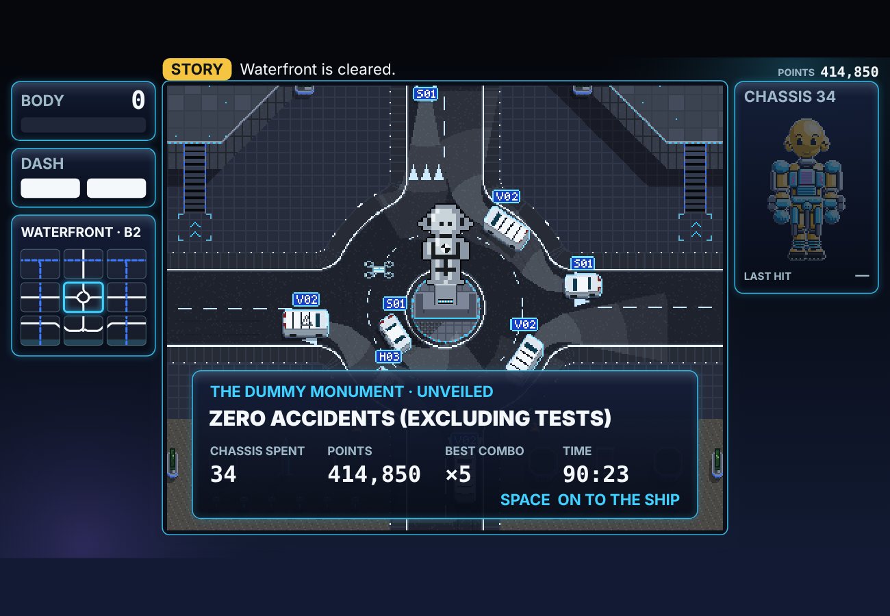
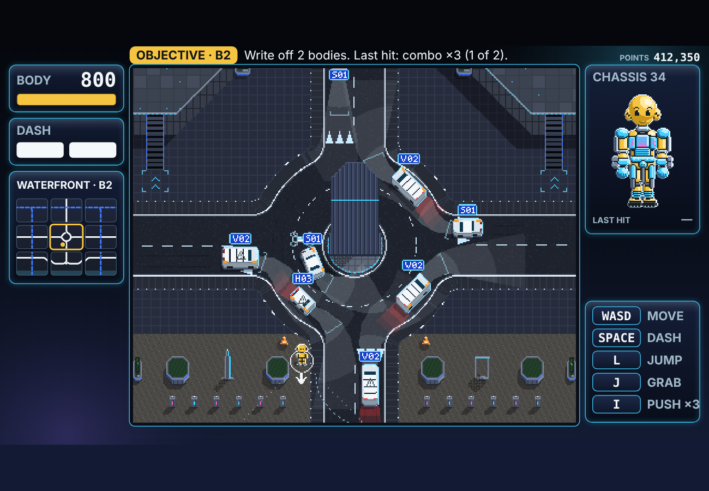
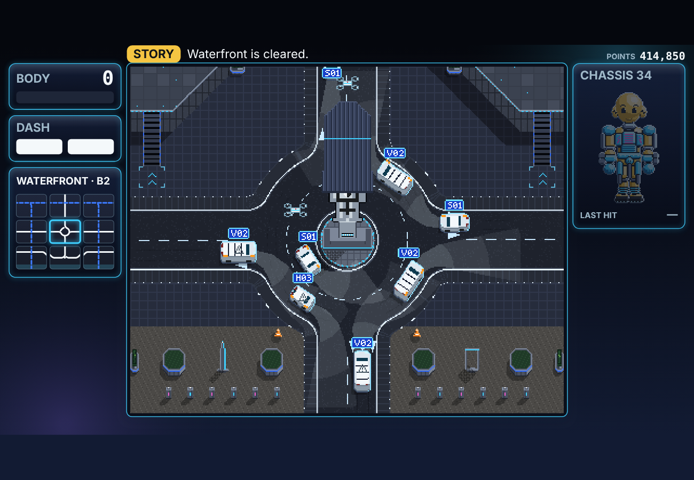
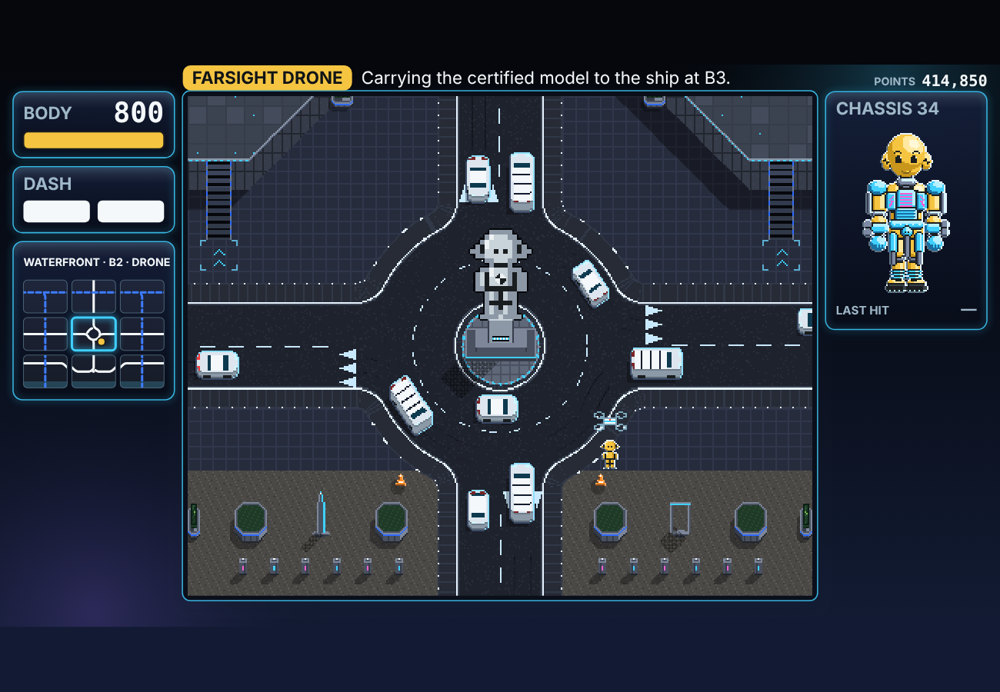
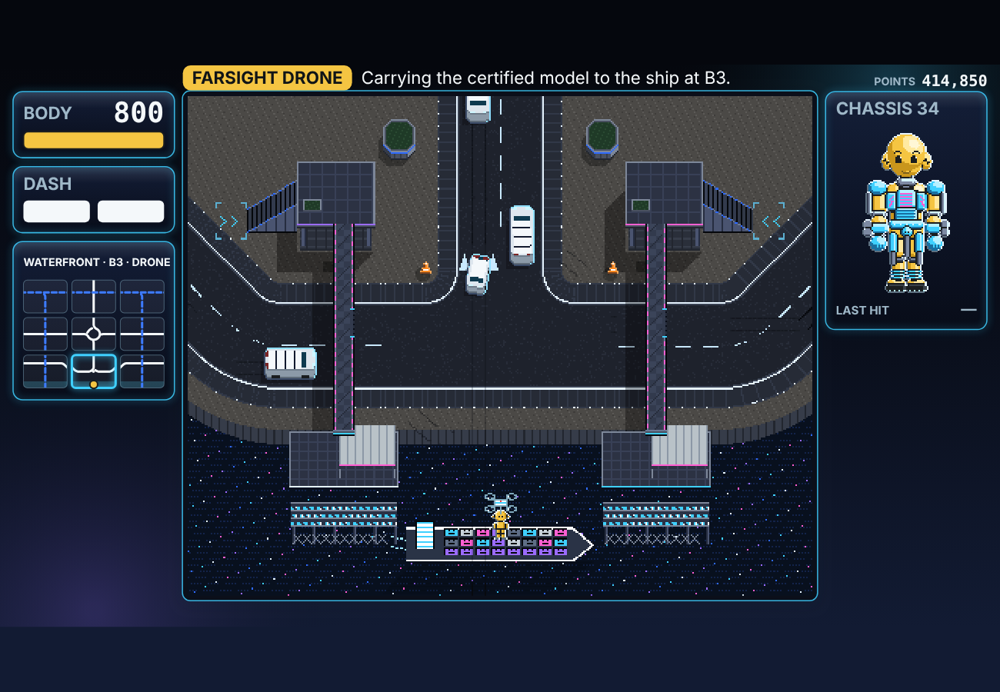
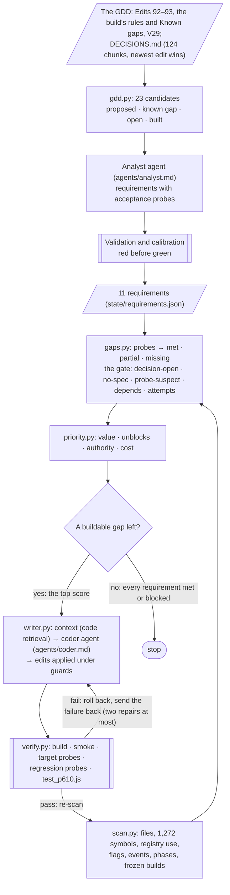

# DUMMIES — Goal-Oriented Coding Agent

**ELVTR Multi-Agent Systems · Assignment 5 · Lawrence Lek · 29 October 2026**

**Capstone:** DUMMIES, a top-down game. You play a crash-test dummy in a Sinofuturist smart city run by FARSIGHT. The city's self-driving cars are its workers. They train not to hit you; you try to get written off.

The agent:

1. Reads the game's own GDD and turns what it marks as unbuilt into requirements, each with executable acceptance probes.
2. Scans the codebase.
3. Runs every probe against the code: the gap-detection pass. A gate blocks what a decision or a spec has not settled.
4. Scores the buildable gaps and picks the top one.
5. Has a coder agent write it, applies the edits under guards, builds the game and verifies the result.
6. Re-scans after every write. It stops when every requirement is met or blocked.

It built the Story's finale, Prototype 7.13: the circus's monument unveiled with its plaque, then a drone to the ship.



## Submission at a glance

| Deliverable | Where |
|---|---|
| **1. Source code** | [`coder/`](coder/) in this repository, a copy of [`coder/` in the working repository](https://github.com/lawrencelek/ELVTR-dummies-agent-crew/tree/assignment4/content-pipeline/coder), where it runs.<br>`coder.py` (the loop) · `gdd.py` · `requirements.py` · `scan.py` · `gaps.py` · `priority.py` · `writer.py` · `verify.py` · `probes.py`, `harness.js`, `page.js` · `agents/analyst.md`, `agents/coder.md` |
| **2. Working feature** | Play: https://lawrencelek.github.io/ELVTR-Multiagent-Submission-5/ (Prototype 7.13). The finale, [§1](#1-what-the-agent-built). See it in a minute: [§1.1](#11-see-it) |
| **3. README** | This file. What it built: [§1](#1-what-the-agent-built). Why that feature: [§3](#3-why-it-chose-the-finale). Manual changes: [§4](#4-manual-changes-before-accepting) |
| **Evidence** | Every agent input, output, patch, probe result and screenshot: [`coder/runs/`](coder/runs/). Each run's `trace.md` has the gap and priority tables per iteration |

| Assignment part | Section |
|---|---|
| Priority scoring | [2.3](#23-priority-scoring) |
| Gap-detection pass | [2.2](#22-the-gap-detection-pass) |
| Code-writing step | [2.4](#24-the-code-writing-step) |
| Iteration loop | [2.5](#25-the-iteration-loop) |

## 1. What the agent built

The GDD specified a finale (Edit 92 §3.2) but the build ended on words: "The finale is words on the ending screen: no unveiling, no flight to the ship yet (D76)." Lawrence closed D76 for this assignment: the unveiling and the ship.

The agent split it into four requirements and built them in this order:

| # | Requirement | What the game does now |
|---|---|---|
| 1 | R-SHROUD | In Story the circus's DUMMY MONUMENT is shrouded until Waterfront B2, the last tile, clears. Arcade's stands uncovered |
| 2 | R-UNVEIL | The last write-off unveils it. The plaque shows the run: chassis spent, points, best combo, time. The best combo is tracked across the whole story and saved |
| 3 | R-VOYAGE | A Farsight drone lifts the dummy from B2, carries it over the edge into B3 and sets it down on the container ship. Then the CERTIFIED ending |
| 4 | R-CRATE-FACES | Every crate on the ship carries the dummy's face. The ship's position is put on the scene, and the voyage lands on it |

A fifth write, R-BARK-TILE, was rejected in review ([§4](#4-manual-changes-before-accepting)).

| | |
|---|---|
|  |  |
| Waterfront B2 in test: the monument under its cloth | The last write-off, then a drone lifts the cloth away |
|  |  |
| A drone carries the certified model south to B3 | Set down on the ship; every crate has the face |

### 1.1 See it

The finale is the end of a 27-tile story. To jump there:

1. Open https://lawrencelek.github.io/ELVTR-Multiagent-Submission-5/finale/. It adds a save, FINALE TEST, one write-off from the end (in the first empty slot, else slot 3), and opens the game.
2. Choose **STORY** (arrow right, SPACE), then **CONTINUE** and **DEPLOY** (SPACE, SPACE). A drone brings the last part; SPACE; SPACE on the tile card.
3. The circus asks for a combo ×3. To skip it, open the browser console and paste:
   ```js
   s = __dummies.sim; s.body.hits.push({ kind: 'dash', cls: 'sedan', combo: 3 }); s.body.health = 0; s.writeOff(); s.checkTerminal();
   ```
4. Watch the cloth lift. SPACE (or tap the plaque) goes on to the ship.

## 2. How the agent works



- **Two agents, one orchestrator.** Each agent call is a fresh headless Claude Code session (`claude -p`, Opus) with its own system prompt, no tools and no shared memory. The orchestrator is plain Python; it applies every edit itself.
- **The coder never grades its own work.** The analyst writes the probes before any code exists. The coder sees them, but only the orchestrator runs them.

### 2.1 Requirements from the GDD

- **Source:** the GDD of record and its newest edits (`coder/gdd/manifest.json`): Edits 92 and 93, the current build's rules with its Known gaps (`prototypes/p7/README.md`), V29 Design and Engineering Spec. Chunked at headings with Assignment 4's BM25 retriever: 124 chunks.
- **Candidates** (`gdd.py`, no model): every bullet the GDD marks *proposed* with a D-item, every Known gap, every Open item, and a few marked *built*. 23 in all.
- **The analyst agent** turns them into atomic requirements. Each has a statement in the GDD's words, its sources, its D-item, how complete its spec is, an impact class, dependencies, the files it will touch, new registry IDs, and 2–5 probes.
  - **Probe kinds:** `registry`, `reads`, `code` (static); `sim` (headless, in Node, against the game's own sims: `coder/harness.js`); `page` (the built game in Chromium: `coder/page.js`).
  - It also excludes what is not a feature: 15 candidates, such as accepted limits and status notes. Chassis 0 and the Expo visitors are excluded because Edit 92 §7 rules them out: "Not drawn".
- **Validation** (no model): every source, D-item, registry ID and dependency exists; no cycle; every probe compiles.
- **Calibration, red before green:** every probe runs on today's code before anything is built.
  - A requirement the GDD marks built must probe *met*. Otherwise the probe is wrong.
  - A proposed one must not. Otherwise the probe cannot tell the feature is missing.
  - A probe that throws is a defect. Missing features must read as false, not crash.
  - Issues go back to the analyst, up to three rounds. The final run needed one. Two stopped runs show what it caught ([§4.3](#43-changes-to-the-agent-while-building-it)).

### 2.2 The gap-detection pass

`gaps.py` compares the scanned code with every requirement, by running its probes:

| State | Meaning |
|---|---|
| met | every probe passes |
| partial | some pass |
| missing | none pass |
| defect | a probe throws |

- Cheap probes run first. A page probe (about 20 s) runs only when the sim probes pass: a page cannot show what the sim lacks.
- **The gate.** A gap is buildable only if nothing blocks it:
  - `decision-open`: its D-item is still open in `DECISIONS.md`. The agent reads this from the log, not from the model.
  - `no-spec`: the GDD names it without saying enough to build it.
  - `probe-suspect`: calibration flagged its probes.
  - `depends`: a requirement it needs is not met.
  - `attempts`: the coder failed it twice.

### 2.3 Priority scoring

`priority.py` scores each buildable gap. Four terms in [0, 1], fixed weights, and a bonus:

| Term | Weight | How it is computed |
|---|---|---|
| value | 0.35 | The impact class the analyst assigns, on a fixed rubric: core 1.0 · reward 0.8 · feedback 0.6 · content 0.4 · tooling 0.2 |
| unblocks | 0.25 | Requirements that wait on it, directly or not, over the most any requirement unblocks. Foundations first |
| authority | 0.15 | Half: the newest GDD rank among its sources. Half: its decision (a closed D-item 1.0; none 0.5) |
| cost | 0.25 | 1 / (1 + 0.5 × files it touches + 0.25 × new registry IDs) |
| partial | +0.10 | Some probes already pass: finish what is started |

Ties break by fewer failed attempts, then by ID. Every term is saved, so each choice can be read back.

### 2.4 The code-writing step

`writer.py` builds one message for the coder agent:

- The requirement and its probes, verbatim: the contract.
- Its GDD chunks, newest first, and its decision rows.
- What earlier writes built, from the ledger, so later requirements use their interfaces.
- The code: outlines of the files it touches; the bodies of the symbols it names; the symbols that BM25 retrieval over the codebase ranks highest for its words (code RAG); Story mode's `story.js` in full. 95–128 KB a message.
- The game's conventions: every number a registry ID; P7 behaviour gated by a flag in `P7SIM`; frozen builds untouched; saves stay compatible; Farsight's voice.

The coder replies with search-and-replace edits, new files and new registry entries. The orchestrator applies them under guards:

- **Paths:** only the game's sources and `story.json`; new files only in `prototypes/p7/`. Never a test, a built page, the agent itself, or a frozen build.
- **Anchors:** each FIND must occur exactly once, or the whole write is refused.
- **Lint:** `node --check` on every JS file written. Every registry-shaped ID in an added line must exist, in the registry or the game's defaults, or come in the REGISTRY block. This enforces the project's rule that every statistic maps to a registry ID.
- **Rollback:** any failure restores every file.

### 2.5 The iteration loop

`coder.py` runs scan → gaps → priority → write → verify, then scans again.

- **Verify** (`verify.py`): the build; a smoke test (the title loads, Story plays); every probe of the target; every probe of every requirement met before the write; and the 6.10 suite on the shared code (`test_p610.js`, 47 checks).
- **Repair:** a failed write is rolled back. The failure and the previous reply go back to the coder. Two repairs at most; then the gap is blocked (`attempts`).
- **Stop:** when no buildable gap is left. Every requirement is met or blocked.
- **Final gate** (`--full`): the game's own suites, `test_sim.js` (104) and `test_p610.js` (47).

## 3. Why it chose the finale

The run: [`coder/runs/20261029-105801/trace.md`](coder/runs/20261029-105801/trace.md). Iteration 1's gap pass:

| Requirement | GDD | State | Blocked by |
|---|---|---|---|
| R-SHROUD: shroud the monument until B2 clears | proposed | missing 0/5 | — |
| R-UNVEIL: unveil it with the run's plaque | proposed | missing 0/5 | depends: R-SHROUD |
| R-VOYAGE: the drone to the ship at B3 | proposed | missing 0/4 | depends: R-UNVEIL |
| R-CRATE-FACES: every crate's face | proposed | missing 0/2 | — |
| R-VOYAGE-CREDITS: credits over the voyage | proposed | missing 0/2 | decision-open: D77 |
| R-SECOND-MARKET: the city again, the cars' learning kept | proposed | missing 0/3 | decision-open: D77 |
| R-TILE-GRADE: grade each cleared tile | known gap | missing 0/2 | no-spec |
| R-BARK-TILE: barks name the tile | known gap | missing 0/1 | — |
| R-PARKLAND-B1-STREET: a street under Parkland B1's highway | known gap | missing 0/3 | decision-open: D70 |
| R-ACT-DELIVERY: the acts and 27 tales | built | met 2/2 | — |
| R-ENDING-SCREEN: the CERTIFIED ending | built | met 3/3 | — |

Three gaps passed the gate. Their scores:

| Requirement | Score | Value | Unblocks | Authority | Cost | Waiting on it |
|---|---|---|---|---|---|---|
| **R-SHROUD** | **0.757** | 0.8 | 1.0 | 1.0 | 0.308 | R-UNVEIL, R-VOYAGE, R-VOYAGE-CREDITS |
| R-BARK-TILE | 0.489 | 0.6 | 0.0 | 0.75 | 0.667 | — |
| R-CRATE-FACES | 0.456 | 0.4 | 0.0 | 0.995 | 0.667 | — |

- **Why the finale first:** it is the reward for finishing the story (value 0.8); its spec comes from a decision Lawrence had just closed (authority 1.0). R-SHROUD is the foundation three other requirements wait on (unblocks 1.0).
- **Why not the cheaper gaps:** R-BARK-TILE and R-CRATE-FACES touch one file each (cost 0.667), but nothing waits on them.
- **Why the order:** once R-SHROUD was met, R-UNVEIL passed the gate and led (0.697), then R-VOYAGE (0.713). The two leaves came last.
- **Why it stopped:** after five writes no buildable gap was left. Credits and Second Market wait on D77; the Parkland street on D70; the tile grade has no spec.

| Iteration | Built | Score | Coder | Verified |
|---|---|---|---|---|
| 1 | R-SHROUD | 0.757 | 83 s, 4 edits, 1 registry ID | first try |
| 2 | R-UNVEIL | 0.697 | 84 s, 8 edits | first try |
| 3 | R-VOYAGE | 0.713 | 136 s, 5 edits | first try |
| 4 | R-BARK-TILE | 0.489 | 27 s, 4 edits | first try (rejected in review) |
| 5 | R-CRATE-FACES | 0.456 | 44 s, 3 edits | first try |
| 6 | — | — | — | stop: every unmet requirement blocked |

The run took 37 minutes, most of it verification. The final gate passed: `test_sim.js` 104/104, `test_p610.js` 47/47.

**After the release** ([`coder/runs/20261029-122040/`](coder/runs/20261029-122040/trace.md)): the agent re-read the GDD, now with Edit 94 and the review's decision rows. It extracted 12 requirements in one round; calibration found no issue.

- The four finale requirements are now marked built in the GDD, and probe met.
- Five are blocked: credits and Second Market (D77), tile barks (D78, raised by the review), the Parkland street (D70), the tile grade (no spec).
- Nothing is buildable, so it stops at once. The next write waits on a decision.

## 4. Manual changes before accepting

The agent's five writes are one commit, [as it made them](https://github.com/lawrencelek/ELVTR-dummies-agent-crew/commit/dbd0a77). The review is the [next commit](https://github.com/lawrencelek/ELVTR-dummies-agent-crew/commit/42e65b6). The probes test state; the review looked at the screen.

### 4.1 Changes to the agent's code

| What | The agent's version | Changed to | Why |
|---|---|---|---|
| The last write-off | The unveiling cut in at once | The write-off plays first (`writeoff` › `unveil`) | The hit needs its beat. The probes could not see the order on screen |
| The unveiling | The cloth vanished between two frames | A drone lifts the cloth away over `ui.finale.unveilSeconds` (1.2 s, a new registry ID, the gift screen's hold). A goes on only then | The GDD asks for an unveiling. Lifted by a drone, as every Farsight delivery is |
| The plaque | Its own monospace text on the raw canvas, below the field's edge; "A · CONTINUE" on every device; no tap | The game's own panel and type, inside the field; SPACE, A or TAP, by device; a tap target | The agent had not seen the UI helpers (it said so in its summary). Every menu must answer a tap (Edit 89) |
| The voyage's labels | "STORY · Waterfront is cleared."; the map read "· RESCUE" | "FARSIGHT DRONE · Carrying the certified model to the ship at B3."; "· DRONE" | As the ferry reads |
| The shroud's registry entry | Group "world", owner "systems" | World, Level design | As the other world flags |

All 11 requirements were probed again after the review: none regressed.

### 4.2 A rejected write

- **R-BARK-TILE** ("Barks still name the district, not the tile") passed every check. Its write replaced the district's name with the tile code in Story's barks. A Luxury sedan would have said "B2. I did not sign up for this."
- It met its one probe, a test hook returning a place word. It did not meet the voice. Barks are written lines in each tier's voice, checked against the fleet canon by Assignment 4's pipeline.
- **Reverted.** The requirement is now `no-spec` with the reason, so the gate blocks it. D78 asks whether to write the lines.
- **Lesson:** a requirement whose spec is thin gets a thin probe, and a thin probe is easy to satisfy. The calibration catches weak probes for features that exist, not for features that do not.

### 4.3 Changes to the agent while building it

These changed the agent, not the game. Each came from a run.

| Run | Found | Fix |
|---|---|---|
| [`20261029-102718-stopped`](coder/runs/20261029-102718-stopped/) | Every page probe that took a screenshot threw: names without `.png` | The harness adds the extension |
| same | A probe tested `run.ending === 'Certified'`; it is an object. Calibration reported it only as a defect | Calibration reports every issue per requirement; "Sim facts" added to the harness API |
| [`20261029-103846-stopped`](coder/runs/20261029-103846-stopped/) | The analyst turned "Chassis 0 lives in the tales, not on screen" into a requirement. Edit 92 §7 rules it out, but retrieval had not given it that chunk (5th by BM25, k was 3) | k = 5; the analyst prompt says to exclude what the GDD rules out |
| both | `proto.droneSpeed` is read by the code but missing from the registry file; the validator refused it | IDs the game defines in code count; new ones still need an entry |
| same | Requirements cited the decision row that closed D76 (`row 533`); the validator refused it as a source | Decision rows count as sources |
| [`20261029-104810`](coder/runs/20261029-104810/) (kept) | 11 requirements in one round: 0 validation errors, 0 calibration issues | — |

### 4.4 Changes outside the agent's scope

- **The decision.** D76 was Lawrence's to close ("Unveiling and ship"). Until then the gate blocked every finale requirement.
- **The release.** Version 7.13 scaffolding (build names, frozen list, title), the release tests (`test_p713.js`, 103 checks with the finale's), the docs, and this deploy.

## 5. Run it

From a clone of the [working repository](https://github.com/lawrencelek/ELVTR-dummies-agent-crew/tree/assignment4/content-pipeline). Python 3.9+, Node 18+, Playwright with Chromium. Model steps need Claude Code signed in (`claude` on the PATH); no API key is stored.

```
python3 coder/coder.py --plan              # requirements, gap table, scores; no writes
python3 coder/coder.py                     # the loop (at most --max-writes 5)
python3 coder/coder.py --full              # and the game's suites at the end
node prototypes/p7/test_p713.js            # the release checks: 103/103
```

To replay the loop's run without model calls, from the commit just before it:

```
git worktree add ../before 5e0e4cd && cd ../before
CODER_REPLAY=$OLDPWD/coder/runs/20261029-105801 python3 coder/coder.py   # the saved coder replies; every check runs again
```

- `--plan` re-extracts the requirements only if the GDD or the decision log changed since `state/requirements.json`. As released, they match: `--plan` makes no model call.
- The game: open `prototypes/p7/dummies_p7_13.html`, or play it here.

## 6. Files

| Path (in `coder/`) | What |
|---|---|
| `coder.py` | The loop, the ledger, the trace |
| `gdd.py`, `gdd/` | The GDD: docs and ranks, chunks, D-items, requirement candidates |
| `requirements.py`, `agents/analyst.md` | The analyst agent; validation; calibration |
| `scan.py` | The scan: files, symbols (a small JS lexer), registry use, flags, events, phases, frozen builds; code retrieval |
| `gaps.py` | The gap-detection pass and the gate |
| `priority.py` | The scores |
| `writer.py`, `agents/coder.md` | The coder agent's context; its reply parsed; guarded apply; rollback |
| `verify.py` | Build, smoke, probes, regression, suites |
| `probes.py`, `harness.js`, `page.js` | The probes: static, headless, page |
| `llm.py` | One headless Claude Code call; saved; replay |
| `state/requirements.json` | The 12 requirements after the release, with every probe |
| `state/requirements_20261029-104810.json` | The 11 requirements the loop built from, with the review's change to R-BARK-TILE |
| `state/ledger.json` | What was built, rejected, when |
| `runs/20261029-104810/` | The analyst's run: candidates, input, output, calibration |
| `runs/20261029-105801/` | The loop's run: each iteration's scan, gaps, scores; each write's input, reply, patch, diff, verification; screenshots |
| `runs/20261029-122040/` | After the release: the GDD re-read, 12 requirements, nothing to build |
| `runs/*-stopped/` | Two runs stopped to fix the agent ([§4.3](#43-changes-to-the-agent-while-building-it)) |

## 7. What I would change next

- **Probe the screen, not only the state.** The review's changes were all visible ones: order, layout, prompts. A critic agent that reads each write's screenshots against the GDD would catch some before a person does.
- **Weight the spec, not only the decision.** R-BARK-TILE's spec was "partial" and scored as buildable. A partial spec could need a human yes before the first write.
- **Give the coder the UI toolkit.** It said twice it had not seen the drawing helpers. Code retrieval should always add them when a requirement draws.

---

# Build changelog

**29 October 2026 · Lawrence Lek** · Prototype 7.13. Spec: GDD Edit 94.

- **Play:** https://lawrencelek.github.io/ELVTR-Multiagent-Submission-5/ (Prototype 7.13)
- **The finale's test save:** https://lawrencelek.github.io/ELVTR-Multiagent-Submission-5/finale/
- **Jump test:** https://lawrencelek.github.io/ELVTR-Multiagent-Submission-5/jump/
- **Control test:** https://lawrencelek.github.io/ELVTR-Multiagent-Submission-5/controls/
- **Prototype 7.12:** https://lawrencelek.github.io/ELVTR-Multiagent-Submission-5/p7-12/
- **Prototype 7.11:** https://lawrencelek.github.io/ELVTR-Multiagent-Submission-5/p7-11/
- **Prototype 7.10:** https://lawrencelek.github.io/ELVTR-Multiagent-Submission-5/p7-10/
- **Prototype 7.9:** https://lawrencelek.github.io/ELVTR-Multiagent-Submission-5/p7-9/
- **Prototype 7.8:** https://lawrencelek.github.io/ELVTR-Multiagent-Submission-5/p7-8/
- **Prototype 7.7:** https://lawrencelek.github.io/ELVTR-Multiagent-Submission-5/p7-7/
- **Prototype 7.6:** https://lawrencelek.github.io/ELVTR-Multiagent-Submission-5/p7-6/
- **Prototype 7.5:** https://lawrencelek.github.io/ELVTR-Multiagent-Submission-5/p7-5/
- **Prototype 7.4:** https://lawrencelek.github.io/ELVTR-Multiagent-Submission-5/p7-4/
- **Prototype 7.3:** https://lawrencelek.github.io/ELVTR-Multiagent-Submission-5/p7-3/
- **Prototype 7.2:** https://lawrencelek.github.io/ELVTR-Multiagent-Submission-5/p7-2/
- **Prototype 7.1:** https://lawrencelek.github.io/ELVTR-Multiagent-Submission-5/p7-1/
- **Prototype 7 (before 7.1's economy):** https://lawrencelek.github.io/ELVTR-Multiagent-Submission-5/p7/
- **Prototype 6.10 (before the modes):** https://lawrencelek.github.io/ELVTR-Multiagent-Submission-5/p6-10/
- Plain web pages: gamepads, touch and keys all work. Claude's hosted preview blocks gamepads.
- **Source:** [lawrencelek/ELVTR-dummies-agent-crew](https://github.com/lawrencelek/ELVTR-dummies-agent-crew/tree/assignment4/content-pipeline/prototypes), `p7/`, `p6/`, `jump/`, `controls/`. The coding agent: `coder/`.

## Files

- `index.html`: the game, Prototype 7.13. Arcade and Story. One file; no server.
- `finale/index.html`: adds the FINALE TEST save, one write-off from the end of the story.
- `coder/`: the coding agent (Assignment 5), with its runs. A copy; it runs in the working repository.
- `docs/`: this README's screenshots.
- `p7-12/index.html`: Prototype 7.12, frozen.
- `p7-11/index.html`: Prototype 7.11, frozen.
- `p7-10/index.html`: Prototype 7.10, frozen.
- `p7-9/index.html`: Prototype 7.9, frozen.
- `p7-8/index.html`: Prototype 7.8, frozen.
- `p7-7/index.html`: Prototype 7.7, frozen.
- `p7-6/index.html`: Prototype 7.6, frozen.
- `p7-5/index.html`: Prototype 7.5, frozen.
- `p7-4/index.html`: Prototype 7.4, frozen.
- `p7-3/index.html`: Prototype 7.3, frozen.
- `p7-2/index.html`: Prototype 7.2, frozen.
- `p7-1/index.html`: Prototype 7.1, frozen.
- `p7/index.html`: Prototype 7, frozen.
- `p6-10/index.html`: Prototype 6.10, frozen.
- `jump/index.html`: the jump test yard. Moving traffic, parked cars, barriers, a ruler, a side view of each jump.
- `controls/index.html`: the control test yard. Pads, touch, keys; three turn models.

## Controls

| | Keys | Gamepad | Touch (phones and tablets, landscape) | Unlocked by |
|---|---|---|---|---|
| Move | WASD / arrows | stick or d-pad | analog stick, left | — |
| Dash | SPACE or K | A (or RT) | A | Battery 1: by drone after Story's first tile; fitted in Arcade |
| Jump | L or SHIFT | B | B | Legs 1 (Story: by drone; Arcade: credits) |
| Pick up a cone | J or E, tap | X, tap | X, tap | Hands 1 (one cone), Hands 2 (two) |
| Put a cone down | J or E, tap away from cones (or hold) | X, tap away from cones | X, tap away from cones (it reads DROP) | Hands 1 |
| Push off a car | I or Q, after a hit or beside a car | Y | Y | Arms 1 |
| Pause | ESC or P | START | ❚❚ PAUSE | — |
| Pad setup | G | hold START | — | — |

- ESC, START or ❚❚ pauses. **Options** (sound, palette, full screen, tuning, pad setup) and **Controls** (for the keyboard, pad or touch you are using) are in the pause menu.
- Touch controls show on touch screens, and appear at your first touch on any phone (S Pen phones too). Add `#touch` to the address to force them.
- On a phone, tap any menu item, card, tile or button. A mouse click works too.
- Touch: Pause › Controls › Adjust layout. Drag the stick or the buttons anywhere, size them (60–160%), Reset. Saved in your browser.
- Press any button on a gamepad first: browsers list a pad only after a press.
- Pad without a standard mapping: press G, then DASH, JUMP, GRAB, PUSH in turn.
- Arcade: the workshop opens after each write-off; credits buy parts. Story: parts come by drone. Tuning (T, desktop) installs ability levels for a test run.

## What 7.13 changes

- Story's finale, built by the coding agent (Assignment 5) and reviewed by hand.
- The circus's monument is shrouded until the last tile, Waterfront B2, clears.
- The last write-off plays. A drone lifts the cloth away. The plaque: ZERO ACCIDENTS (EXCLUDING TESTS), then your chassis spent, points, best combo and time.
- SPACE, A or a tap: a drone carries you from the circus to the container ship at B3. Every crate carries your face. Then CERTIFIED.
- Arcade is unchanged.

## What 7.12 changes

- Story only. Each part arrives on the tile that first asks for it, and that tile tests it.
- B1 brings the dash and asks for one: DASH INTO A CAR. C1 asks you to drop onto a car from the high road.
- Monument teaches three moves: dash (B1), cones (A2), jump (B3). The push arrives at the start of Parkland.
- Parkland: Arms 1 C1, Legs 2 A3, Hands 2 A2, Arms 2 A1, Battery 2 B2. Waterfront: Legs 3 B1, Arms 3 B3, Battery 3 on the last tile, the circus.
- Monument C3 asks you to be thrown into a car; one write-off. Parkland B1 asks for a raised road, not a cone. 34 bodies in all.

## What 7.11 changes

- The story is Narrative A, Certified. You arrive off the factory floor as Farsight's new staff; the cars are your colleagues.
  - Act I, Monument: Induction. Act II, Parkland: Opening Day. Act III, Waterfront: Customs. Every tile has a new tale.
  - The end: your model passes and will be manufactured; a drone takes you to a ship bound for a market far away.
- New tile names: The welcome wall, The neon shops, The dome by the canal, the east and west customs posts.
- New tile art, for looks only: the LED wall shows your face and WELCOME; neon shop signs; the gateway reads THANK YOU · DRIVE SAFE; a paper lantern; water falling down the cascade; CUSTOMS on the pier towers; a container ship on the river.

## What 7.10 changes

- Story: every part comes by drone on a set tile, when its task needs it. No levels; points are your score.
  - Battery 1, the dash, arrives after the first tile. Battery 2 is a second charge; Battery 3 recharges faster.
- Arcade: buy every part with credits in the workshop. The dash comes fitted.
- Story's first tile is on foot, with 500 health.
- Miss Farsight's brief with a hit that would finish you, and the chassis holds at 1 health. Keep going.
- Points sit small in the top-right corner. The chassis turns red where it is damaged, with the damage beside each part.
- A monument to the dummy stands in the middle of Waterfront's circus.

## What 7.9 changes

- Dash, then jump: the jump out of a dash no longer needs a second charge.
- Cones: tap X to pick one up; tap X again, away from cones, to put it down. On a phone the button reads GRAB or DROP.
- Buttons tell the truth: in menus A reads OK and B BACK; in play a button shows its move only once you have it.

## What 7.8 changes

- Touch everywhere: every menu answers a tap. Touch controls appear at the first touch, also on S Pen phones (Galaxy S25 Ultra).
- Story has no credits now. Points level the dummy up: level 2 at 6,500 points, up to level 9. Each level gives one upgrade.
- LEVEL UP flashes across the screen in play, with a fanfare. The top-right box shows your points, level and a bar to the next.
- The workshop: your next chassis stands in the middle, its parts around it. Tap a part, then FIT. Parts a drone has not brought yet stay hidden ("???").
- Arcade keeps credits, in the same workshop.

## What 7.7 changes

- Save games. STORY opens a save screen: NEW GAME and three slots.
- Each slot shows its name, the date and time of its last save, where the story stands (map, tile, tiles cleared), points, credits, upgrades and chassis.
- CONTINUE, RENAME (up to 12 characters) or ERASE a slot. Erasing and overwriting ask twice.
- Type the name on a keyboard; on a pad, use the letter grid; on a phone, tap the keys or tap the name for the phone's keyboard.
- The game saves by itself after every write-off, clear, gift and purchase. A story from 7.6 in your browser appears in slot 1.

## What 7.6 changes

- One top edge: BODY, the game screen and a new POINTS · CREDITS box line up. The chassis sits under the box. Arcade's box: POINTS · CARS LEFT.
- The objective moves to the top strip. The map panel reads the map and tile, e.g. MONUMENT · A1.
- Touch: small PAUSE and FULL chips, top left. Everything fits the 16:9 centre.
- Touch: move and size the stick and the buttons yourself (Pause › Controls › Adjust layout). On a wide phone such as the S25 Ultra, put them in the side margins.

## What 7.5 changes

- A clean screen: nothing under the game. Options and controls moved into the pause menu.
- The pause menu's Controls page shows the device you are holding: keyboard, gamepad or touch.
- BODY is as tall as DASH, so the map sits higher and the touch stick has room. No FARSIGHT logo in play.

## What 7.4 changes

- Story: traffic is tuned tile by tile. The opening tiles and Parkland's quiet ones get more cars. Arcade keeps one level per map.
- Every highway has a staircase, and a lit gap in the railing over each road below: walk off it to drop onto the cars.
- Waterfront's bridges gain a staircase from the beach.
- Cones sit beside the road where you can see them: never on the road, under a highway or behind a building.

## What 7.3 changes

- Verbs are given, levels are bought. Legs 1, Hands 1 and Arms 1 arrive by drone; the shop never sells them.
- Story: Monument hands out a verb every three tiles: Legs 1 at C1, Hands 1 at A2, Arms 1 at C3.
- Arcade: the same verbs in the same order, one after each write-off.
- You see the drone bring it: a glowing case under the drone, lowered onto the dummy.
- Then a gift screen: the dummy's body, large; the new part falls onto it with a flash, rays and a fanfare. A continues; the drone carries you on.

## What 7.2 changes

- By default the dummy has two dashes, the standard recharge and recoil, and no other ability.
- Story: the upgrade tracks fill only at the end of Waterfront. 35 bodies certify the city.
- Hits throw the dummy less: a head-on hit slides it about a lane, not across the screen.
- After a clear, a Farsight drone carries the dummy into the next tile and sets it down off the road.
- Bounded edges glow yellow, as in Zelda; nothing blocks the road. Cleared tiles stay open.
- Maps: uncleared tiles grey, the live tile ringed in yellow.
- Cars speak in bubbles again. The objective sits on the bottom line.

## What 7.1 changes

- One credit for every body destroyed, in both modes.
- Story upgrades: level 1 costs 3 credits, level 2 costs 4, level 3 costs 5. Arcade keeps 1, 2, 3.
- Each story tile wants its own number of write-offs, 1 to 3: 62 bodies to certify the city.
- Only the last hit counts against Farsight's brief. Arcade plays one district a run.

## What 7 adds

- The title offers two modes.
- **ARCADE:** the 6.10 game. Pick Parkland, Waterfront or Monument; each district is a whole run.
- **STORY:** the Test City, tile by tile. Monument, then Parkland, then Waterfront: 27 tiles.
  - Each tile tells how that part of the city came to be, and gives Farsight's brief.
  - Write-offs that meet the brief clear a tile. Other write-offs score but don't count.
  - The tile is fenced until it is cleared. The fences can't be jumped. Cleared tiles stay open.
  - Every body pays a credit. Some tiles bring a gift.
  - The map opens one tile at a time. Progress is saved in your browser.

## Menus

| | Keys | Gamepad | Touch |
|---|---|---|---|
| Choose | arrows | stick or d-pad | stick |
| Select, begin | SPACE | A | A |
| Back | SHIFT | B | B |

## 6.10

- Hands (X), two levels: tap to pick up a cone, hold 0.3 s to put it down. Hands 1 carries one cone, Hands 2 two. No throw.
- Arms (Y), three levels: push off a car you just hit or touch, a ricochet you time.
  - Push: +160, +200, +240 u/s. Pushes before landing: 1, 2, 3. They refill on the ground.
  - Dash into a car, push off it into the next: a two-kind combo, ×2.
- With no Arms, the bounce off a car stays the Newtonian one.
- The throw, the hitch and the cone link are gone. Tuning (T) has every push value.

## 6.9

- Three abilities, three levels: Battery (dash charge 1 s, then 0.8, 0.7, 0.6), Legs (0.3, 0.4, 0.5 s in the air), Arms (carry, hold X to throw, hitch).
- Hitch: grab a passing car, ride it, let go at its speed, or sling off with A into the next car.
- Combos: mixing moves climbs faster (to ×5); jumps, bounces, slings and hitches hold the combo clock; a thrown cone into a car links; a meter shows the chain.
- Every value is in Tuning (T).

## 6.8

- Four levels per ability. Legs: 0.3 to 0.6 s in the air. Arms: carry 1 to 4 cones. Throw: +40 range a level. Battery: −0.1 s a charge a level.
- The shop shows one card per ability; A buys its next level.
- Hits bounce the dummy with Newtonian momentum: a head-on hit throws it far, into the next car for a combo. Tune it in Tuning (T).
- Jump test: [ and ] change the Legs level.

## 6.7

- The shop sells four abilities, one per button, three levels each: Battery (A), Legs (B), Arms (X), Throw (Y).
- Level 1 gives the ability. Every level cuts how much damage wears it, 25% a level.
- Battery levels speed the dash recharge: 0.8 s a charge, down to 0.41 s. Torso damage slows it.
- Walk and jump: a hop, it clears nothing. Run and jump to clear.
- Jump test: diagonal jumps. A running jump clears a handrail to 55° off square, a sedan to 32°.

## 6.6

- The screen fills the window at any scale, not only ×2 or ×3.
- Touch controls only on phones and tablets, drawn in the HUD's glass style.
- The jump keeps its take-off speed (Link's Awakening): standing 0, walking 41, running 81. B during a dash: a long jump, 162.
- A running jump clears a sedan broadside; a dash jump clears a van. A bus: never.
- Fixed: the dummy froze dashing past a stair head onto a walkway (Monument B2).
